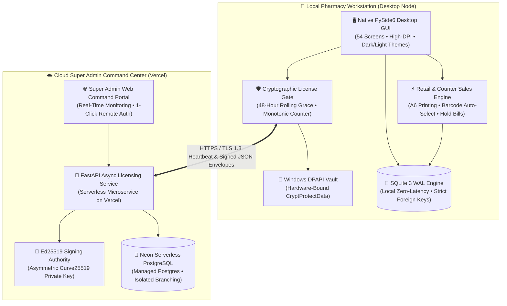

<p align="center">
  
</p>

<p align="center">
  <a href="https://www.python.org/downloads/release/python-3130/"></a>
  <a href="https://doc.qt.io/qtforpython-6/"></a>
  <a href="https://fastapi.tiangolo.com/"></a>
  <a href="https://neon.tech/"></a>
  <a href="https://www.sqlite.org/"></a>
  <a href="https://vercel.com/"></a>
</p>

<p align="center">
  
  
  
  
  
  
</p>

---

## 📌 Executive Overview

**Pharmacy Management System (PMS)** is an enterprise-grade, high-performance Windows desktop ERP tailored specifically for pharmacies, retail medical stores, multi-counter dispensaries, and pharmaceutical wholesalers. 

Engineered with a **Dual-Engine Architecture**, the system merges the raw, microsecond-level responsiveness of a native desktop application with modern cloud-scale cryptographic governance:

1. **Local High-Performance Engine (Desktop Client):** Powered by **PySide6 (Qt 6.8+)** and a local **SQLite 3 database with Write-Ahead Logging (WAL)**. Cashiers and pharmacists enjoy zero-latency counter sales, sub-second barcode lookups, instantaneous batch selection, and uninterrupted operation even during complete internet blackouts.
2. **Cloud Super Admin Command Center (Cloud Service):** Built on **FastAPI** and **Neon Serverless PostgreSQL**, deployed on **Vercel**. Provides central administrators real-time device health monitoring, remote license provisioning, instantaneous cryptographic authorization/revocation, audit trail telemetry, and branch control.
3. **Cryptographic Identity & Offline Resilience:** Device licensing is enforced using **asymmetric Ed25519 digital signatures** verified locally against hardware-bound identifiers stored in the **Windows DPAPI (Data Protection API)** vault. Workstations operate with a guaranteed **48-hour offline grace period**, ensuring pharmacy counters never halt operations during network disruptions.

---

## 🏛️ System Architecture

### Component Topology & Data Flow



### Architectural Layout

```text
+-----------------------------------------------------------------------------------+
|                        LOCAL PHARMACY DESKTOP WORKSTATION                        |
|                                                                                   |
|   +---------------------------------------------------------------------------+   |
|   |                  PySide6 / Qt6 High-Speed Native Desktop UI               |   |
|   |         (54 Modular Screens • Light & Dark Themes • High-DPI Support)      |   |
|   +-------------------------------------+-------------------------------------+   |
|                                         |                                         |
|                 +-----------------------+-----------------------+                 |
|                 |                                               |                 |
|   +-------------v---------------+               +---------------v-------------+   |
|   |   POS & Inventory Engine    |               |  Cryptographic Client Gate  |   |
|   |   - A6 Thermal Bill Printer |               |  - Ed25519 Curve Verify     |   |
|   |   - Auto Batch & Expiry Sel |               |  - 48-Hour Offline Grace    |   |
|   |   - H1 / NRX Sales Logs     |               |  - Windows DPAPI Key Vault  |   |
|   +-------------+---------------+               +---------------+-------------+   |
|                 |                                               |                 |
|   +-------------v---------------+                               |                 |
|   |   SQLite 3 WAL Database     |                               |                 |
|   |   (Local, ACID, 0ms Lag)    |                               |                 |
|   +-----------------------------+                               |                 |
+-----------------------------------------------------------------|-----------------+
                                                                  |
                                       Encrypted TLS 1.3 Requests | Signed Ed25519
                                       Hardware Nonce + Device ID | License Envelopes
                                                                  |
+-----------------------------------------------------------------v-----------------+
|                        CLOUD SUPER ADMIN COMMAND CENTER                           |
|                        (FastAPI + Neon PostgreSQL on Vercel)                      |
|                                                                                   |
|   +-----------------------------+               +-----------------------------+   |
|   |   FastAPI REST API Engine   | <-----------> |  Ed25519 Private Signer     |   |
|   |   (Serverless, Micro-routes)|               |  (Hardware Peppered HMAC)   |   |
|   +--------------+--------------+               +-----------------------------+   |
|                  |                                                                |
|   +--------------v--------------+               +-----------------------------+   |
|   |   Neon Serverless Postgres  | <-----------> |  Web Command Dashboard      |   |
|   |   (Branching, TLS Enforced) |               |  (1-Click Remote Provision) |   |
|   +-----------------------------+               +-----------------------------+   |
+-----------------------------------------------------------------------------------+
```

---

## 🛠️ Technical Specifications

| Tier | Component | Technology / Standard | Purpose & Capabilities |
| :--- | :--- | :--- | :--- |
| **Desktop Application** | UI Framework | **PySide6 / Qt 6.8+** | Native 60 FPS rendering, customized QSS styles, keyboard event filters, high-DPI scaling. |
| **Runtime Engine** | Language Runtime | **Python 3.13.x** | Fast, optimized execution, modern typing, robust platform integration. |
| **Local Persistence** | Embedded Storage | **SQLite 3 (WAL Mode)** | Atomic transactions, concurrent reads during writes, strict foreign-key enforcement, zero-latency I/O. |
| **Secure Key Storage** | Credential Vault | **Windows DPAPI** | Hardware-backed kernel encryption via `CryptProtectData` without plaintext config files. |
| **Cryptographic Protocol**| Digital Signature | **Ed25519 (Curve25519)** | High-speed asymmetric authentication, tamper-proof license envelope signing and verification. |
| **Licensing Cloud** | Microservice API | **FastAPI + Uvicorn** | High-throughput asynchronous REST endpoints, heartbeat monitoring, automated license generation. |
| **Central Database** | Cloud Data Store | **Neon PostgreSQL** | Serverless cloud PostgreSQL with automated branch isolation (`preview` vs `production`) and SSL enforcement. |
| **Cloud Hosting** | Edge & Serverless | **Vercel** | Global low-latency API deployment, instant serverless execution, continuous deployment. |
| **Printing & Documents** | Reporting Engine | **PySide6 QtPrintSupport** | Precision A6 format (105 × 148 mm) thermal & laser receipts, custom PDF rendering. |
| **Data Interop** | Spreadsheets | **openpyxl** | Master catalog bulk migration, validation, preview, and template-based Excel importing. |

---

## 🎯 Full Feature Breakdown

### 🛒 1. Retail & Counter Sales (Point of Sale)
* **A6 Compact Bill Printing:** Built-in printer engine outputting precision **A6 portrait bills (105 × 148 mm)** formatted specifically for pharmacy thermal or laser printers, including clinic headers, patient names, prescribing doctors, batch numbers, expiry dates, and tax summaries.
* **Intelligent Batch Selection:** Dynamic stock matching automatically prioritizes batches nearing expiry or following strict FIFO rules. Stock availability is verified instantly at item addition.
* **Held Bills Queue:** Park active customer carts with a single keystroke to serve urgent customers, then resume the suspended bill with all batch allocations intact.
* **Barcode & Shortcut Navigation:** Complete keyboard-driven workflow. Cashiers can enter items by barcode, generic molecule name, brand name, or custom shortcut code without touching a mouse.
* **Customer Returns & Credit Notes:** Process partial or full customer medicine returns with instant stock restoration and automatic credit note ledger adjustments.
* **Doctor Attribution & Commissions:** Prescribing doctors can be tagged per bill or per line-item, feeding directly into doctor-wise sales and prescription analytics.
* **Customer Saving Highlights:** Live calculation and printing of total customer savings relative to maximum retail price (MRP).

### 📦 2. Master Catalog & Data Management
The system provides **9 distinct master catalog entities** ensuring complete relational integrity:
1. **Item Master:** Central directory of pharmaceutical products, formulation types, barcodes, HSN codes, manufacturer references, purchase rates, and MRPs.
2. **Category Master:** Therapeutic and operational categorization (e.g., Antibiotics, Analgesics, Cardiac Care, Syrups, Injectables).
3. **Unit Master:** Comprehensive unit conversions and dispensing measures (Strips, Tablets, Bottles, Vials, Ampoules, Tubes, Boxes).
4. **Company Master:** Pharmaceutical manufacturers and brand distributors.
5. **Drug / Generic Molecule Master:** Active pharmaceutical ingredients (APIs) and generic molecule cross-references for substitute matching.
6. **Supplier Master:** Wholesalers and vendor profiles with Drug License (DL) numbers, GSTIN, payment terms, and credit limits.
7. **Customer Master:** Patient directory tracking contact details, chronic disease tags, outstanding credit balances, and dispensing histories.
8. **Doctor Master:** Prescribing physicians, medical registration council numbers, clinic locations, and specialties.
9. **Account Group Master:** Standard double-entry chart-of-accounts structure (Current Assets, Sundry Debtors, Sundry Creditors, Direct Expenses).
* **Bulk Excel/CSV Import Wizard:** Multi-step wizard supporting Company, Unit, Drug, Supplier, Customer, Doctor, and Item masters with column mapping, data validation, and dry-run error reporting.

### 🏭 3. Purchasing & Inventory Control
* **Wholesale Purchase Invoicing:** Record complex wholesale vendor invoices including supplier invoice numbers, date checks, multi-tax splits, cash/trade discounts, and freight charges.
* **Free Quantity Calculations:** Transparent accounting for pharmaceutical trade bonus schemes (e.g., 10 + 2 Free, 100 + 15 Free) with automatic unit cost recalculation.
* **Batch-Level Tracking & Expiry Quarantine:** Every stock unit is tracked by its unique manufacturing batch and expiration date. Expired stocks are automatically flagged and quarantined from counter sale selections.
* **Purchase Debit Notes:** Seamless vendor returns for damaged, recalled, or expired items with automatic reversal of purchase accounts and supplier liabilities.
* **Physical Stock Adjustment:** Reconcile system records with physical store audits. Handles breakage, leakages, and stock variances with mandatory audit reason logging.
* **Supplier Delivery Challans:** Log inbound consignments prior to receipt of final invoices with conversion tools.

### 📊 4. Full Double-Entry Accounting Suite
Integrated financial engine adhering strictly to Indian standard accounting practices:
* **Double-Entry General Ledger:** Automatic posting of all counter sales, purchases, payments, receipts, and returns directly to corresponding debits and credits.
* **Cash Book & Bank Book:** Real-time visibility into liquid cash counter balances, bank deposits, withdrawals, cheques, and electronic clearing transfers.
* **Customer Receipt & Supplier Payment Vouchers:** Settle outstanding invoices bill-by-bill with support for partial payments, cash discounts, and round-offs.
* **Day End Reconciliation:** Formal end-of-shift cash drawer audit tallying physical currency against system sales, card receipts, and digital transfers.
* **Journal Entries:** Manual voucher entries for non-operational adjustments, office expenses, depreciation, and partner accounts.
* **Trial Balance, Profit & Loss, Balance Sheet:** Instant generation of financial health statements factoring Cost of Goods Sold (COGS), gross margins, operating expenses, and inventory valuations.
* **Financial Year Manager:** Flexible multi-year accounting support with date validations and year-specific reporting.

### ⚖️ 5. Government Compliance & Statutory Registers
* **Schedule H1 Register:** Fully compliant sale and purchase registers for 3rd schedule antibiotics and habit-forming drugs, capturing patient names, addresses, prescribing doctors, batch numbers, and dispensed quantities.
* **Schedule NRX Narcotic Register:** Strict tracking and audit registers for Narcotic and Psychotropic substances as mandated by national drug enforcement regulations.
* **GST Summary Reports:** Comprehensive tax breakdown detailing total taxable turnover, CGST, SGST, IGST, and cess across 0%, 5%, 12%, 18%, and 28% tax slabs.

### 🛡️ 6. Offline-First Architecture & Ed25519 Cryptographic Licensing
* **100% Offline Resilience:** Workstations operate completely autonomously using the local SQLite WAL engine. Billing and dispensing never fail due to internet dropouts.
* **48-Hour Offline Grace Guarantee:** Once authorized by the central server, the local cryptographic gate provides a 48-hour continuous operational window without requiring active server heartbeats.
* **Asymmetric Ed25519 Digital Signatures:** Licenses are signed using an enterprise Curve25519 private key on the server. The desktop verifies signatures using a public key, preventing key spoofing or fake license generators.
* **Windows DPAPI Vault:** Cryptographic tokens, machine identifiers, and device nonces are protected using the operating system's `CryptProtectData` kernel API, tied to the local Windows user profile.
* **Anti-Tamper & Anti-Replay Defense:** The licensing protocol utilizes cryptographically secure nonces, monotonic time verifications, and machine hardware hashing (CPU + Motherboard UUID) to prevent clock tampering or license cloning.

### ☁️ 7. Cloud Super Admin Command Center
* **Real-Time Device Monitoring:** View all connected pharmacy workstations, online/offline status, IP addresses, last seen timestamps, and software versions.
* **Remote One-Click Authorization:** Authorize new counter installations or instantly revoke compromised nodes with a single click from any web browser.
* **Centralized License Issuance:** Generate enterprise license keys, set validity periods, and configure maximum authorized terminal limits.
* **Audit Trail Logging:** Complete historical log of administrative actions, device activations, authentication attempts, and operational heartbeats.

---

## 🗺️ Comprehensive Screen Map (54 Modular Screens)

The desktop application features **54 specialized functional screens** built with PySide6, organized logically into 7 core operational domains:

```text
┌────────────────────────────────────────────────────────────────────────────────────────┐
│                        PHARMACY MANAGEMENT SYSTEM - 54 SCREENS                         │
├───────────────────────┬────────────────────────┬───────────────────────────────────────┤
│ Operational Domain    │ Screen Title           │ Source File                           │
├───────────────────────┼────────────────────────┼───────────────────────────────────────┤
│ 1. Sales & POS        │ Counter Sale / New Bill│ screens/counter_sale.py               │
│    (5 Screens)        │ Hold Bill Manager      │ screens/hold_bill.py                  │
│                       │ Patient Bill History   │ screens/sales_history.py              │
│                       │ Patient History (Bill#)│ screens/patient_history_bill_wise.py  │
│                       │ Day End Summary        │ screens/day_end.py                    │
├───────────────────────┼────────────────────────┼───────────────────────────────────────┤
│ 2. Purchasing         │ Purchase Invoice       │ screens/purchase_invoice.py           │
│    (4 Screens)        │ Stock Adjustment List  │ screens/adjusted_stock_list.py        │
│                       │ Debit Note (Supplier)  │ screens/debit_note.py                 │
│                       │ Credit Note (Customer) │ screens/credit_note.py                │
├───────────────────────┼────────────────────────┼───────────────────────────────────────┤
│ 3. Accounting Suite   │ Supplier Payment       │ screens/supplier_payment.py           │
│    (10 Screens)       │ Customer Receipt       │ screens/customer_receipt.py           │
│                       │ Cash Book              │ screens/cash_book.py                  │
│                       │ Bank Book              │ screens/bank_book.py                  │
│                       │ Account Ledger         │ screens/account_ledger.py             │
│                       │ Journal Entry          │ screens/journal_entry.py              │
│                       │ Account Roles Mapping  │ screens/account_roles.py              │
│                       │ Trial Balance          │ screens/trial_balance.py              │
│                       │ Profit & Loss          │ screens/profit_loss.py                │
│                       │ Balance Sheet          │ screens/balance_sheet.py              │
├───────────────────────┼────────────────────────┼───────────────────────────────────────┤
│ 4. Reports & BI       │ Daily Billwise Sales   │ screens/sales_reports.py              │
│    (18 Screens)       │ Daily Itemwise Sales   │ screens/sales_reports.py              │
│                       │ Companywise Sales      │ screens/sales_reports.py              │
│                       │ Itemwise Sales         │ screens/sales_reports.py              │
│                       │ Profit Calculation     │ screens/daily_profit_calculation.py   │
│                       │ Daily Profit Calc      │ screens/sales_reports.py              │
│                       │ Daily Profit Itemwise  │ screens/sales_reports.py              │
│                       │ Sales Report           │ screens/sales_report.py               │
│                       │ Duplicate Sales Bill   │ screens/duplicate_sales_bill.py       │
│                       │ Purchase Report        │ screens/purchase_report.py            │
│                       │ Co.-wise Item Purchase │ screens/purchase_reports.py           │
│                       │ Co.-wise Supp. Purchase│ screens/purchase_reports.py           │
│                       │ Supp. Item Purchase Inv│ screens/purchase_reports.py           │
│                       │ Supp. Item Purch. Chal.│ screens/purchase_reports.py           │
│                       │ Itemwise Purchase      │ screens/purchase_reports.py           │
│                       │ Item Batch Purchase    │ screens/purchase_reports.py           │
│                       │ Items (All) Stock      │ screens/stock_reports.py              │
│                       │ Companywise Item Stock │ screens/stock_reports.py              │
├───────────────────────┼────────────────────────┼───────────────────────────────────────┤
│ 5. Stock & Clinical   │ Expired Item List      │ screens/stock_reports.py              │
│    (7 Screens)        │ Item List Catalog      │ screens/stock_reports.py              │
│                       │ Expiry Horizon Report  │ screens/expiry_report.py              │
│                       │ Doctorwise Item Sale   │ screens/doctor_reports.py             │
│                       │ Doctor Item Sale Detail│ screens/doctor_reports.py             │
│                       │ Party Wise Report      │ screens/party_wise_report.py          │
│                       │ GST Summary Report     │ screens/gst_report.py                 │
├───────────────────────┼────────────────────────┼───────────────────────────────────────┤
│ 6. Master Catalogs    │ Item Master            │ screens/item_master.py                │
│    (13 Screens)       │ Company Master         │ screens/company_master.py             │
│                       │ Unit Master            │ screens/unit_master.py                │
│                       │ Category Master        │ screens/category_master.py            │
│                       │ Drug Molecule Master   │ screens/drug_master.py                │
│                       │ Supplier Master        │ screens/supplier_master.py            │
│                       │ Customer Master        │ screens/customer_master.py            │
│                       │ Doctor Master          │ screens/doctor_master.py              │
│                       │ Account Group Master   │ screens/account_group_master.py       │
│                       │ Data Import Wizard     │ screens/import_data.py                │
│                       │ Financial Year Manager │ screens/financial_year.py             │
│                       │ User Management (RBAC) │ screens/user_management.py            │
│                       │ Backup & Restore       │ screens/backup_restore.py             │
├───────────────────────┼────────────────────────┼───────────────────────────────────────┤
│ 7. Compliance & Gate  │ Schedule H1 Registers  │ screens/schedule_reports.py           │
│    (Regulatory)       │ Schedule NRX Registers │ screens/schedule_reports.py           │
│                       │ Enterprise Login       │ screens/login.py                      │
│                       │ License Gate & Lockout │ licensing/qt.py                       │
└───────────────────────┴────────────────────────┴───────────────────────────────────────┘
```

---

## ⚡ Quickstart & Command Guide

### 1. Prerequisites
* **Operating System:** Windows 10 or Windows 11 (64-bit recommended)
* **Python Runtime:** Python **3.13.x**
* **PowerShell:** Windows PowerShell 5.1 or PowerShell Core 7+

### 2. Environment Setup

Clone the repository and initialize the dedicated virtual environment:

```powershell
# Create Python 3.13 virtual environment
py -3.13 -m venv .venv

# Activate the virtual environment
.\.venv\Scripts\Activate.ps1

# Upgrade package management tools
python -m pip install --upgrade pip setuptools wheel

# Install all production dependencies
python -m pip install -r requirements.txt
```

---

### 3. Running the Desktop Application

#### Production Mode (Recommended)
The production launcher connects to `data\pharmacy.db`, verifies database integrity and schema completeness, and prevents initialization of blank databases:

```powershell
# Run preflight database check
.\run_production.ps1 check

# Launch the desktop application
.\run_production.ps1
```

#### Direct Python Execution
```powershell
python main.py
```

---

### 4. Running the Isolated Staging Environment
Test migrations, perform dry-run imports, and audit accounting reports without altering live business records:

```powershell
# Launches strictly with staging\pharmacy_staging.db in [STAGING / AUDIT MODE]
.\run_staging.ps1
```

---

### 5. Running the Cloud Super Admin Web Server Locally
Launch the asynchronous FastAPI administration dashboard and licensing authority:

```powershell
# Starts FastAPI server on http://127.0.0.1:8000
python run_web.py
```

* **Command Center Portal:** `http://127.0.0.1:8000/admin`
* **Features:** Terminal heartbeat monitoring, license token generator, remote station authorization, audit logs.

---

### 6. Building the Standalone Windows Executable

The project includes an optimized PyInstaller specification that packages the desktop application into a standalone distribution:

```powershell
# Build single-directory release (dist\PharmacyManagement\PharmacyManagement.exe)
python -m PyInstaller build\windows\pharmacy_management.spec --noconfirm

# Or build single-file release (dist\PharmacyManagement.exe)
python -m PyInstaller build\windows\pharmacy_management_onefile.spec --noconfirm

# Target alias shortcut:
python -m PyInstaller PharmacyManagement.spec
```

> [!NOTE]
> Packaged executables store live business databases under `%LOCALAPPDATA%\PharmacyManagementSystem\`, keeping pharmacy data isolated and safe from application updates.

---

## ⌨️ Keyboard Shortcuts & Hotkey Reference

Designed for rapid, mouse-free point-of-sale execution. Work effortlessly during peak pharmacy rush hours:

| Shortcut | Context | Functional Action |
| :--- | :--- | :--- |
| <kbd>Alt</kbd> + <kbd>S</kbd> | Counter Sale | **Save Bill / Open Payment Modal** (Press again to finalize and print) |
| <kbd>Ctrl</kbd> + <kbd>S</kbd> | Global | **Open Counter Sale / New Bill** |
| <kbd>Ctrl</kbd> + <kbd>B</kbd> | Global | **Open Sales Bill / Patient Bill History** |
| <kbd>Ctrl</kbd> + <kbd>I</kbd> | Global | **Open Purchase Invoice** |
| <kbd>Ctrl</kbd> + <kbd>A</kbd> | Global | **Open Stock Adjustment** |
| <kbd>Ctrl</kbd> + <kbd>C</kbd> | Global | **Open Credit Note (Customer Return)** |
| <kbd>Ctrl</kbd> + <kbd>D</kbd> | Global | **Open Debit Note (Supplier Return)** |
| <kbd>Ctrl</kbd> + <kbd>P</kbd> | Global | **Open Supplier Payment Voucher** |
| <kbd>Ctrl</kbd> + <kbd>R</kbd> | Global | **Open Customer Receipt Voucher** |
| <kbd>Ctrl</kbd> + <kbd>G</kbd> | Global | **Open GST Tax Summary Report** |
| <kbd>Ctrl</kbd> + <kbd>T</kbd> | Global | **Open Daily Itemwise Sales Report** |
| <kbd>Ctrl</kbd> + <kbd>H</kbd> | Global | **Open Supplier Purchase Challan Report** |
| <kbd>Enter</kbd> / <kbd>Return</kbd> | POS & Forms | **Advance focus to next field / Confirm popup selection** |
| <kbd>F2</kbd> | Counter Sale | **Confirm selected medicine or batch from autocomplete** |
| <kbd>Esc</kbd> | Dialogs & Popups | **Close active modal, dismiss dropdown, or cancel transaction** |
| <kbd>Up</kbd> / <kbd>Down</kbd> | Table / Lists | **Navigate batch or medicine autocomplete suggestions** |
| <kbd>Tab</kbd> / <kbd>Shift</kbd>+<kbd>Tab</kbd> | All Screens | **Cycle through form inputs and action buttons** |
| <kbd>Alt</kbd> + <kbd>F4</kbd> | Global | **Safely exit application with active WAL checkpoint** |

---

## 🔒 Security, Compliance & Data Safeguards

1. **Zero Plaintext Fallbacks:** Workstation secrets, license validation tokens, and offline grace nonces are protected using the Windows Data Protection API (DPAPI) and never stored in plaintext `.env` or registry keys.
2. **Crash-Safe SQLite WAL Mode:** Uses SQLite Write-Ahead Logging. If a workstation abruptly loses power during an active sale, uncommitted transactions are cleanly rolled back, preserving complete database integrity.
3. **Automated Safety Backups:** The Backup & Restore module creates full pre-restore snapshots before executing any database recovery operation.
4. **Role-Based Access Control (RBAC):** Restricts high-privilege operations (financial year closure, user management, database restoration, stock adjustments) to authenticated `ADMIN` accounts.

---

## 🧪 Automated Verification & Testing

Execute the comprehensive test suite to verify accounting balance equations, database migrations, and UI flows:

```powershell
# Run the complete test suite against an isolated SQLite snapshot
python run_tests.py
```

---

<p align="center">
  <sub>Pharmacy Management System &bull; Built with PySide6, SQLite WAL, FastAPI, and Neon PostgreSQL</sub>
</p>
