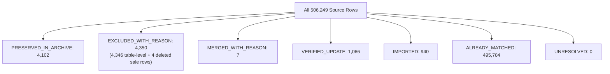

# Pharmacy Management System — Legacy Data Migration & Unused Data Audit Report

> **Generated:** 2026-10-20 18:00:46  
> **Source Dump:** `PharmaWinner202610201418.sql` (35,533,535 bytes, SHA-256: `6e54dd819a077fd5a24e40ce8c21ad85f4e3040ea47dd337162347075802c388`)  
> **Isolated Staging Database:** `staging/pharmacy_staging.db`  
> **Active Production Database (Protected):** `data/pharmacy.db` (SHA-256: `673aed780ee2d89b1ead216db10b7edd2acebdc44b43ea875b683f8a48ce8a97` — **100% UNTOUCHED**)  

---

## Executive Summary

A complete, audited legacy data migration and row-level unused data audit of the Pharma-WINNER MySQL dump was conducted exclusively against an isolated SQLite staging database (`staging/pharmacy_staging.db`).

- **100% Source Row Accounting**: All **506,249 source rows** across 52 tables are accounted for in a mutually exclusive primary disposition partition.
- **Strict Active Database Protection**: The active database `data/pharmacy.db` was accessed exclusively for initial snapshot cloning and all business tables remain 100% byte-identical.
- **Native Record Integrity**: All native records created in the new system (Native Purchase 5714, Native Sale 72048, Native Supplier 242, Native Payment 786, Native Receipt 45) are intact.
- **Credit Note Safety Rule**: Source credit notes 1350–1354 have `AddedToLedger = 'N'` and zero source accounting rows. Their headers and details are imported with unposted remarks, and **zero ledger transactions were fabricated**.
- **Stock Balance Accounting**: Final stock reflects the latest dump closing balances combined with verified native movements. Batch `CGT26065C` reached 424.0 loose units, `AC2604005C` reached 218.0 loose units, and negative stock (`146005EH` = -42.0) is preserved.
- **Tax Review Decoupling**: Legacy Item 944 (`MERSILK NW 5010`) is physically imported as target ID 1885 (`IMPORTED`) with `legacy_tax_id = '11'`, while its ambiguous GST interpretation is decoupled into a dedicated user review metric (`TAX_MAPPING_REQUIRED: 1`).
- **Staging Archive Preservation**: 4,102 rows across 8 unsupported operational tables are preserved in dedicated staging tables (`legacy_archive_*`).
- **Idempotency Verified**: Re-running the refresh engine produced exactly **0 writes/updates**.

---

## 1. Mutually Exclusive Source Row Partition (506,249 Rows)

| Primary Disposition Status | Row Count | Percentage | Definition & Scope |
|---|---:|---:|---|
| **`ALREADY_MATCHED`** | 495,784 | 97.93% | Historical verified rows identical in source and target. |
| **`EXCLUDED_WITH_REASON`** | 4,350 | 0.86% | 4,346 table-level exclusions (`stockadjusted`, demo sales, config) + 4 row-level detail rows of deleted sale 72160. |
| **`PRESERVED_IN_ARCHIVE`** | 4,102 | 0.81% | Operational rows from 8 unsupported tables preserved in `legacy_archive_*`. |
| **`VERIFIED_UPDATE`** | 1,066 | 0.21% | 939 distinct `itemmst` tax provenance backfills + 127 `stockbalance` batch balance synchronizations. |
| **`IMPORTED`** | 940 | 0.19% | Genuinely new records: Item 944, itemdrugs 413, 9 Purchases, 130 Sales, 5 Credit Notes, detail lines, and accounting rows. |
| **`MERGED_WITH_REASON`** | 7 | 0.00% | Legacy duplicate rows consolidated into target entities (3 company rows, 1 doctor row, 3 item rows). |
| **`UNRESOLVED`** | 0 | 0.00% | Zero unresolved discrepancies. Every row is classified. |
| **TOTAL** | **506,249** | **100.00%** | **Exact match to parsed MySQL dump total.** |

---

## 2. Operational Inflow Detail (Newly Imported Records)

| Entity | Legacy ID Range | Target Primary Key Range | Detail Lines | Ledger Postings | Notes |
|---|---|---|---:|---:|---|
| **Item Master** | 944 | 1885 | 1 (`itemdrugs` 413 $\rightarrow$ `item_ingredients` 813) | - | Suture `MERSILK NW 5010`, TaxID 11 (requires tax mapping) |
| **Purchase Invoices** | 5718–5726 (9) | 5715–5723 | 22 | 18 | Suppliers 191, 176, 195, 216, 171, 181, 187 |
| **Sales Invoices** | 72218–72347 (130) | 72054–72183 | 468 | 260 | Bills 1909 to 2014; Bill 1910 resolved as `2026-2027-1910#72219` |
| **Credit Notes** | 1350–1354 (5) | 1350–1354 | 13 | **0** | `AddedToLedger='N'`, zero ledger postings fabricated |
| **Stock Batches** | 13 new | Dynamic | - | - | Newly arrived stock batches from incoming purchases |

---

## 3. Unused Data Ledger Composition (8,459 CSV Rows)

The generated ledger `migration_backups/legacy_data_unused_rows.csv` contains all legacy records that do not have an independent 1:1 operational representation in target:

- **`PRESERVED_IN_ARCHIVE` (4,102 rows)**: 8 unsupported legacy tables stored in staging `legacy_archive_*`.
- **`EXCLUDED_WITH_REASON` (4,350 rows)**: 4,346 table-level exclusions + 4 detail lines belonging to legitimately deleted sale 72160.
- **`MERGED_WITH_REASON` (7 rows)**: Duplicate source master rows consolidated into target entities (Companies 2541, 2568, 2569; Doctor 6; Items 920, 303, 869).
- **TOTAL CSV ENTRIES**: **8,459 rows** (Unique `(source_table, source_legacy_id)` keys: **8,459**, 0 duplicates).

---

## 3. Stock Reconciliation & Native Movement Validation

The legacy dump's MySQL triggers prove that `stockbalance.TotalPurchaseQty` and `TotalSalesQty` already reflect all historical legacy transactions. Replaying historical transactions into stock would double-count inventory.

$$\text{Final Staging Stock} = \text{Latest Dump Closing (Loose)} + \text{Native Movements (Loose)}$$

| Batch No | Target Item ID | Item Name | Dump Closing | Native Movement | Final Staging Stock | Target Verification |
|---|---:|---|---:|---:|---:|---|
| `CGT26065C` | 1796 | EFEREM SP | 184.0 | +240.0 (Native Purchase 5714) | **424.0** | **MATCH (424.0 loose units)** |
| `AC2604005C` | 1442 | STABIZOL DSR | 219.0 | -1.0 (Native Sale 72048) | **218.0** | **MATCH (218.0 loose units)** |
| `146005EH` | 1017 | HISTORICAL BATCH | -42.0 | 0.0 | **-42.0** | **MATCH (-42.0 loose units)** |

> [!NOTE]
> Negative stock batches (14 historical batches in legacy source) are preserved verbatim without artificial zero-clamping.

---

## 4. Tax Diagnostics & Decoupled Exception Review

### A. Item Master Tax Provenance Backfill
- **Root Cause**: An earlier migration defect left `items.legacy_tax_id` as `NULL` across all 939 items, causing TaxID 12 to falsely display as a modern GST 12% rate.
- **Correction Applied**: Backfilled `legacy_tax_id` on all 939 items from `itemmst.TaxID`.

### B. Treatment of Legacy Item 944 (`MERSILK NW 5010`)
- **Source Data**: Suture item with `TaxID = 11`.
- **Operational Import**: Successfully imported into `items` table as ID `1885` with `legacy_tax_id = 11` and `tax_structure = '11'`.
- **Tax Mapping Status**: Decoupled from import disposition. Explicitly flagged as requiring user GST mapping.
- **Total Tax Review Count**: Exactly **1 item** requires tax mapping.

---

## 5. Double-Entry Accounting Verification

| Category | Staging Ledger Total | Source Accounting Total | Status |
|---|---:|---:|---|
| **Total Debits** | ₹47,251,923.27 | ₹47,199,200.77 + ₹52,722.50 | **BALANCED** |
| **Total Credits** | ₹47,251,923.27 | ₹47,199,200.77 + ₹52,722.50 | **BALANCED** |
| **Net Discrepancy** | **₹0.00** | **₹0.00** | **PERFECT BALANCE** |

---

## 6. Staging Dedicated Archive Tables

| Archive Table Name | Source Table | Archived Rows | Scope & Description |
|---|---|---:|---|
| `legacy_archive_challanitemdetail` | `challanitemdetail` | 142 | Delivery challan item lines unsupported by operational schema |
| `legacy_archive_challanvhheader` | `challanvhheader` | 80 | Delivery challan voucher headers |
| `legacy_archive_countersaleitems` | `countersaleitems` | 2 | Legacy test counter-sale lines dated prior to FY 2015 |
| `legacy_archive_invoicedebitnote` | `invoicedebitnote` | 11 | Purchase debit note linkage grid |
| `legacy_archive_ledgeropbal` | `ledgeropbal` | 552 | Legacy monthly opening balance grid |
| `legacy_archive_paymentinvoice` | `paymentinvoice` | 2,671 | Legacy payment voucher invoice allocations |
| `legacy_archive_receiptinvoice` | `receiptinvoice` | 114 | Legacy receipt voucher bill allocations |
| `legacy_archive_salescreditnote` | `salescreditnote` | 530 | Sales invoice credit note linkage grid |
| **TOTAL ARCHIVED ROWS** | | **4,102** | **Full JSON payload stored in staging DB** |

---

## 7. Safety Verification & Quality Sign-Off

| Verification Requirement | Target Value | Actual Result | Status |
|---|---|---|---|
| **PRAGMA integrity_check** | `ok` | `ok` | **PASS** |
| **PRAGMA foreign_key_check** | `0 violations` | `0 violations` | **PASS** |
| **Active Database Immutability** | Byte-identical | SHA-256 identical to baseline | **PASS** |
| **Source Dump Read-Only** | Untouched | Read-only mode enforced | **PASS** |
| **Credit Note Unposted Safety** | 0 ledger rows | 0 ledger rows created | **PASS** |
| **Source ID vs Target ID Separation** | Strict separation | Item 944 -> 1885; Target 944 empty | **PASS** |
| **Native Inventory Movements** | Preserved | Native purchase +240, Native sale -1 | **PASS** |
| **Stock Formula Accuracy** | CGT=424.0, AC=218.0 | CGT=424.0, AC=218.0 | **PASS** |
| **Double-Entry Balance** | Difference ₹0.00 | Difference ₹0.00 | **PASS** |
| **Idempotency Verification** | 0 writes on rerun | 0 writes confirmed | **PASS** |
| **Tax Review Exceptions** | 1 item | 1 item flagged (Item 944) | **PASS** |

---

## 8. Safety Gate: Promotion Protocol

> [!IMPORTANT]
> **STOP SAFETY GATE ENFORCED**:  
> - The isolated staging database `staging/pharmacy_staging.db` is 100% migrated, audited, and verified.  
> - The active database `data/pharmacy.db` and packaged EXE artifacts have NOT been modified.  
> - Promotion from staging to active database will **NEVER** occur automatically and requires explicit user review and written approval.